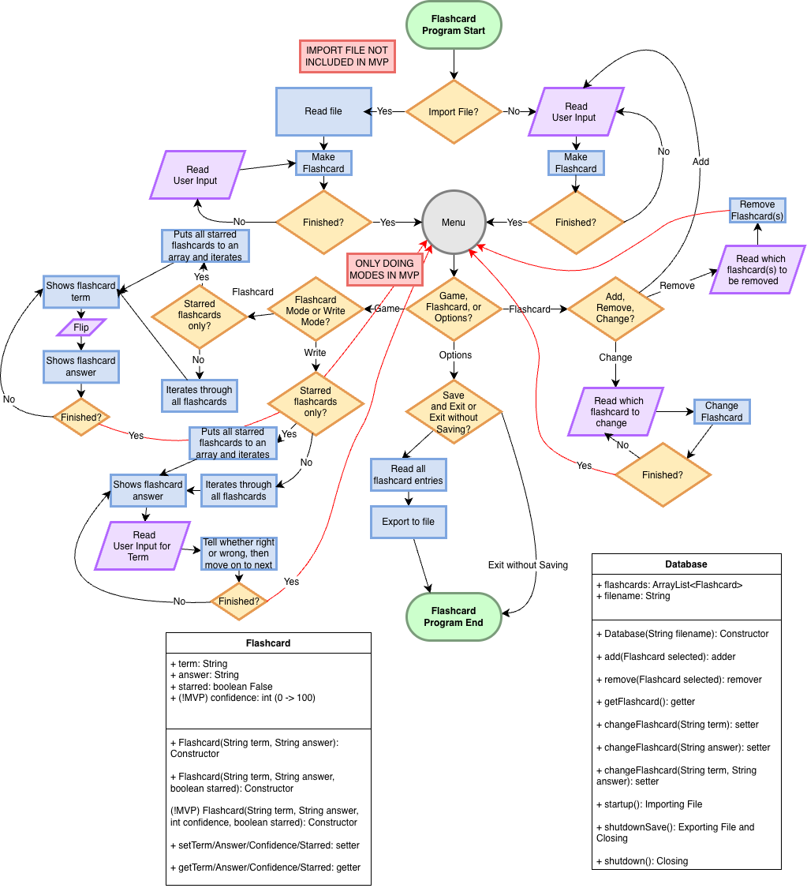

# Flashcard Study

A Java program for flashcard-based studying, with various modes to help with studying flashcards. 

## The Problem

Popular flashcard-based study apps like Quizlet and Knowt require an internet connection to use their features, like the Learn or Test modes, or even to use the website itself. The connection on campus isn't consistently good, so students need a study tool that isn't limited by internet connection.

## How It Works

A paragraph or a few bullets explaining what the software does at a
high level. If you have a diagram, embed it here:



## Tech Stack

- **Language:** Java
- **Libraries:** ObjectInput/OutputStream, FileInput/OutputStream, ArrayList, Scanner
- **External tools:** No external tools

## Setup

Step-by-step: how does someone who just cloned your repo get it
running?

```bash
git clone https://github.com/you/your-project
cd your-project
./install.sh   # or whatever
```

## Usage

How to actually run the thing, with examples.

```bash
./backup.sh ~/Documents
```

## Roadmap

- [ ] Construct flashcard objects with a “confidence” level
- [ ] Learn mode, similar to Quizlet and Knowt, changes the “confidence” level. If the user gets the question wrong, the user can correct it to say they got it right.
- [ ] Test mode, which randomizes the flashcards to make multiple choice, written, or true/false. User will choose which question to answer when the test is made, along with a “done” button to finish
- [ ] “Chain” mode, original gamemode where you try to get as many questions correct as possible, sets a static high score.


## Author

Colin Sirait, https://github.com/acrymaricatari
